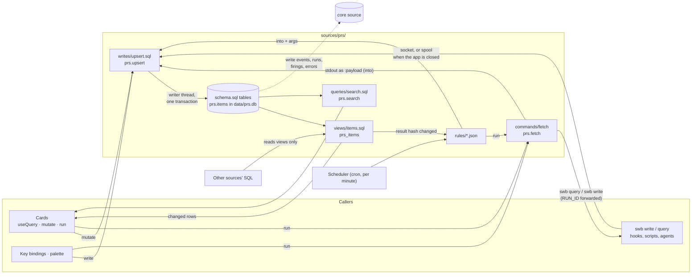
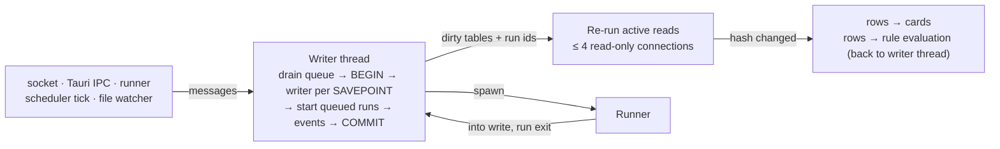

# Switchboard: architecture

A personal Tauri + React app for directing attention across Slack, Jira, PRs, monitoring and agents. Agents extend it by writing files to `~/.switchboard`, which the app checks and loads.

| Path             |                                                                                 |
| ---------------- | ------------------------------------------------------------------------------- |
| `core/`          | loader (incl. card compiler), engine, runner, snapshots, embedded `core` source |
| `cli/`           | `swb`                                                                          |
| `app/`           | shell (React + Vite) and the `switchboard` card module                            |
| `app/src-tauri/` | Tauri wrapper; bundles `swb` as a sidecar                                      |
| `template/`      | default folder contents                                                         |

## Principles

- Sources hold all data and logic. Cards only display.
- A source's tables are private. Its views are its public interface.
- Every write goes through the backend, as a named SQL writer.
- Rules are the only automatic trigger.
- Tables only grow. Schema changes are hidden behind views.
- The backend keeps no state outside `core` tables.
- One loader both checks and enforces. Dependencies are derived from the files, never declared.

## Folder: `~/.switchboard` (git repo, `data/` ignored)

```
settings.json            app-wide defaults and preferences
keymap.json              key → command or writer
rules/*.json             rules that belong to no single source
cards/*.tsx, cards/lib/  card components (Root.tsx is the entry point) and their helpers
sources/<name>/
  source.json            optional: item card, snapshot and timeout overrides
  schema.sql             private tables (no file = no database)
  views/*.sql            parameterless SELECTs: public, joinable, watchable
  queries/*.sql          parameterised SELECTs: callable by name, not joinable
  writes/*.sql           mutations of this source's tables
  commands/*             scripts that fetch or act
  rules/*.json           rules that belong to this source
  files/                 config and helpers for its commands; committed, not loaded
data/                    <source>.db (WAL), logs/, snapshots/, trash/, spool/, swb.sock, engine.lock
AGENTS.md                what agents need to maintain the folder
```

Every part of a source is optional; any other entry is a loader error. A source without a schema is a namespace for commands, queries or cross-source views.

## Inside a source



Only the source's writers write its tables, and everything else reads it through its views and queries. Commands call external systems, and read and write the source with `swb query` and `swb write`.

## Sources

| Form                                      | Meaning                     | Usable from                        |
| ----------------------------------------- | --------------------------- | ---------------------------------- |
| `prs.items`                               | private table, in SQL       | only files inside `sources/prs/`   |
| `prs_items`                               | view, in SQL and `useQuery` | anywhere                           |
| `prs.search`, `prs.dismiss`, `prs.fix-ci` | query, writer, command      | cards, rules, key bindings, `swb` |

Source names are `[a-z][a-z0-9]*` (no `_`, since views are `<source>_<file>`). A ref is `source:id`, e.g. `prs:4812`.

- **Views** are one parameterless `SELECT`, registered as temp views on the engine's connections (so they exist only inside the app; `swb query` reads them from outside). They read their own source's tables and any views. Their columns are their contract. `now` is evaluated only when the view re-runs, which is after a dependent write or on a rule's schedule.
- **Queries** are parameterised `SELECT`s for what a view plus equality filters cannot express. Not joinable, not watchable by rules.
- **Writers** are one or more statements run in one savepoint, with named params, writing only their own source. Bulk input arrives as JSON in `:payload`; `:run_id` is bound to the calling run.
- **Commands** are scripts that take IDs and look up the rest with `swb query`. They never open a database. A fetching command prints JSON and its rule's `into` writer stores it. They run with the folder as cwd, in their own process group, with the login-shell environment captured once at start, `RUN_ID`, `SWITCHBOARD_HOME`, `SOURCE_DIR`, `SWB` and `SWB_ARG_<NAME>` (args are also JSON on stdin), a timeout (setting, `source.json` or rule), and output in `data/logs/<run_id>.log`. Agent launches are ordinary commands: wait on `<agent> -p` and exit with its result, or detach, exit `open`, and finish later.
- **Portability:** a source is self-contained; copying its folder in and passing `swb check` installs it. Its files contain its own name, so it cannot be renamed without editing them. Rules start firing as soon as it loads.

## Rules

```json
{ "id": "fix-failing-ci", "when": { "view": "prs_ci_failed" }, "key": "{id}@{head_sha}", "run": "prs.fix-ci", "args": { "pr": "{id}" } }
{ "id": "prs-poll", "when": { "schedule": "*/2 * * * *" }, "run": "prs.fetch", "into": "prs.upsert" }
```

- `when.view` is evaluated on load and whenever its result hash changes after a write. It fires once per new rendered key; seen keys live in `core.firings`.
- `when.schedule` is a local cron checked every minute. With a view, it re-evaluates the view; alone, it fires once per slot keyed `slot:<time>`. After sleep, only the most recent missed slot fires; a new rule starts at its next slot.
- `when.files` is a glob watched outside the folder. A matching file fires once it has been quiet for 200 ms, keyed `file:<path>@<time>`; with `when.line_contains`, once per appended complete line containing the text, keyed `file:<path>@<offset>`. Offsets start at each file's length when the rules load, so existing content never fires.
- `when.system` fires on `sleep`, `wake`, `lock`, `unlock`, `online` and `offline`, keyed `system:<event>@<time>`. The app observes them and calls `Engine::system_event`; core debounces `offline` by `offline_debounce` and drops the `online` that ends a brief drop. A rule takes at most one of `schedule`, `files` and `system`, and like a schedule, each occurrence re-evaluates its view or fires it once.
- `run` starts a command; `into` names a writer that receives the command's stdout as `:payload`. A rule with only `into` calls the writer with `args`: with a view this still records a run (so depth applies), while a writer rule without a view records only its firing, writes with origin `rule:<id>` and no run, and starts a new lineage.
- Schedules are the only time mechanism. The loader warns when a rule watches a `now`-dependent view without a schedule.

Limits, all computed from `core` tables:

- **Depth:** a firing caused by writes from runs takes the deepest of those runs as parent. Past `max_depth` (5) it is blocked. `RUN_ID` reaches everything a command starts, and `swb write` forwards it.
- **Rate:** a rule with `when.view` or `when.files` that has started `max_per_hour` runs in the last hour (counted in `core.runs`) is blocked and disabled until `core.rule_enable`. Schedule and system rules are bounded by their cron and the machine.
- **Concurrency:** at most `max_concurrency` rule runs are `running` (`core.notify` exempt); the rest stay `queued`.
- A blocked firing records its reason and consumes its key; retrying is manual. Runs started by hand are never limited.

## Engine



- **Write path:** one writer connection with every source DB attached and every view as a temp view. Each loop iteration drains all pending messages into one transaction (group commit), then starts queued runs, writes buffered events, commits and replies.
- **Invalidation:** when the loader prepares a view or query, SQLite's authorizer reports every base table it reads, through any depth of views; writers report the tables they write. After a commit, every active read (subscribed by a card or watched by a rule) whose tables intersect the dirty set is re-run. Only a changed result hash is pushed to cards or evaluated by rules. Granularity is per table, and a whole result is re-sent when it changes.
- **Runner:** spawns command processes, enforces timeouts by killing the process group, captures stdout for `into` and the outcome line, and reports the exit back to the writer thread. The tick marks `running` runs whose process is gone and expired `open` runs as `unknown`, and trims events and runs past `retention`.
- **Reload:** file changes (debounced 100 ms; `data/`, `.git` and `switchboard.d.ts` ignored) re-run the loader. Only a clean load is swapped in: connections are rebuilt, subscriptions re-resolved, rules re-synced, and changed cards pushed for hot reload. Otherwise the last good state keeps running and the errors go to `core_events`. If the folder fails at startup, the app runs the `core` source alone.
- **Socket:** `data/swb.sock` serves `swb`. On start, `data/spool/` is replayed in order before accepting connections.
- **Wrapper (Tauri):** IPC commands for the shell, `core.notify` as macOS notifications (clicking brings the window forward), the row count of the `menu_bar` view in the menu bar, the global `hotkey`, and closing the window hides it. One instance per folder, enforced by `data/engine.lock`.

## Storage

- One SQLite file per source, attached under the source's name (attach limit raised to 125 at build time). Only the engine writes.
- **`schema.sql` is additive-only:** `CREATE TABLE` and `CREATE INDEX` only. New tables and columns are applied automatically; drops, renames and column definition changes are refused; indexes may change freely. Changes to table-level constraints are not detected.
- **Reshaping** is a new table, a one-off copy writer, and views switched to it. A new source is for redesigning the public interface.
- **`@deprecated`** on a column's line or above a `CREATE TABLE` makes the loader refuse views and queries that read it.
- **Orphans:** a DB whose source folder is gone moves to `data/trash/`, deleted after 30 days.
- **Snapshots:** every minute, a database changed since its latest snapshot and older than `snapshot_interval` is copied with `VACUUM INTO`; snapshots past `snapshot_retention` are deleted, keeping the latest. `core.restore` snapshots the current data, restores via the backup API and reloads.
- **Conventions:** provider JSON in a `raw` column; user state in its own table joined in the view; a primary key on every table.

## Core source

Embedded in the binary, written only by the engine, and the only source whose schema may drop tables.

- **`runs`:** id, command, args, state, parent, depth, rule, pid, summary, commit, timestamps.
  ```
  queued → running → success | failure | open
  open → success | failure      (swb run finish, core.run_finish, or a rule)
  running → unknown             (process gone)
  open → unknown                (open_run_expiry)
  ```
  Exit code sets the state; a last stdout line `{outcome, summary}` refines it (except for `into` runs).
- **`firings`:** rule, key (unique together), run, time, blocked reason, commit. Kept long-term except trigger occurrence keys (`slot:`, `file:`, `system:`), trimmed after 7 days. A rule without a view can set `log: false` to record neither firings (other than blocked ones) nor write events; a view rule cannot, since its firings are what remember the keys it fired.
- **`rules`:** enabled, disabled reason, last evaluated.
- **`events`:** writes that changed rows (with trigger and run), errors of every kind (`loader`, `sql`, `card_runtime`, `spool`, `runner`, …), and reads slower than 100 ms. The engine's own bookkeeping writes produce no events.
- **Views:** `core_runs`, `core_firings`, `core_rules`, `core_items` (rules as `core:<rule>` refs) and `core_events` expose every row and never filter; consumers filter on top. Indexes cover the common filters (`kind`, `run_id`, `name`, `state`, `rule`). Mounting a view over a growing table re-sends the whole result after every write unless its filter keeps the result small; for recent history, cards use a query with a limit.
- **Queries** `core.timeline {limit}` (runs, firings and events, newest first) `core.events {kind, limit}` (newest events of a kind) and `core.runs {limit}` (newest runs).
- **Writers** `core.rule_enable` and `core.run_finish`; **commands** `core.snapshot`, `core.restore`, `core.notify`.

`attention` and the Health card are template sources and cards over these views and queries.

## Loader and `swb check`

One function takes the folder and returns a loaded configuration or diagnostics. The engine calls it on change, `swb check` and the git pre-commit hook call it directly.

- Each `schema.sql` runs in an in-memory scratch database under the authorizer; the real DB is opened read-only for the additive diff, and the plan is applied only after the whole folder passes.
- Every SQL file is prepared on a connection with the scratch DBs attached. A second pass replaces each view with an empty table of the same columns, so each reported table access belongs to the statement itself. This pass detects reads of other sources' tables, writes outside the source and reads of deprecated columns.
- It also checks: read-only views and queries, no parameters in views, no `SELECT *`, no `ATTACH`/`PRAGMA`/DDL/transactions/introspection table functions; rule references and that template variables are view columns; key binding targets; `source.json` and `settings.json` fields.
- Cards and `cards/lib/` are compiled in-process with oxc (TypeScript, JSX) into modules held in memory, with imports restricted to `react`, `react/jsx-runtime`, `switchboard` and `cards/lib/`.
- Warnings: unused views and queries, a missing root card, `now` views watched without a schedule.

## `swb` CLI

Talks to the app over `data/swb.sock`.

- `swb write <source.writer> [name=value ...] [< payload]`: spooled to `data/spool/` if the app is closed; at-least-once.
- `swb query <view | source.query> [name=value ...]`
- `swb run finish <run_id> --ok|--fail [summary]`
- `swb check`

## Front end

The shell renders one root card. All layout is cards rendering cards.

- **Shell owns:** `<CardSlot>`, the palette (cmd-k: shell commands, commands and writers), keymap and context stack, focus, and an error boundary whose root instance offers "revert last commit".
- **`<CardSlot component props size id>`** is the only way cards compose. Each slot has its own error boundary and context frame. Nesting is capped at `depth_cap`.
- **`<Item ref>`** renders a ref with its source's `item_card`, or as text.
- **Card API** (`switchboard` module, provided at runtime like React): `useQuery` on a view (with equality filters) or a query, `mutate`, `run`, `useExpose`. Identical subscriptions are shared. The app writes `cards/switchboard.d.ts` on start.
- Cards are fetched over IPC as compiled module bundles and evaluated in the webview; each card gets its own instance of the helpers it imports.
- **State:** navigation and layout are data in the view-less `ui` source; other per-slot state is in local storage keyed by the slot id.
- **Undo:** `git revert` for the folder, `core.restore` for data.

## Keymap

- The context stack is the chain of focused card frames, e.g. `card:Root > card:Boards > card:Grid > card:PRList`. `size` and `focused` are reserved variables; others come from `useExpose`.
- Bindings target a command or a writer, with predicates `&&`, `||`, `!`, `>` and parentheses. The innermost match wins, `null` unbinds, a missing variable disables the binding (greyed in the palette), and variables are read at keypress.
- `keymap.context` shows the active stack and which binding a key hits.

## Default template

On first run the app copies `template/` into the folder, runs `git init`, installs the pre-commit hook and commits. The template's sources and cards are ordinary files and can be replaced.

- **`sessions`:** Claude Code hooks call `swb write sessions.claude_hook`, which sets each session's status: `working`, `needs_permission`, `needs_input`, `ready`, `errored` or `ended`. No hook fires on an interrupt, so the `sessions-interrupted` rule watches transcripts (`when.files` with `line_contains`) for Claude's interrupt marker and sets the session back to `ready`. `sessions.launch {prompt, cwd}` opens a terminal session (the run succeeds once the terminal opens; the session's status lives in `sessions.items`), `sessions.edit {prompt}` edits the folder headlessly and commits with the prompt as message. Both pass `files/claude-hooks.json` to `claude --settings`.
- **`attention`:** items with one open per ref; `raise`, `clear`, `snooze`, `wake`. Rules wake due snoozes every minute, `core.notify` for items of level ≥ 2 when raised and each time they wake from a snooze (up to 60 per hour), and raise blocked firings.
- **`ui`:** boards and grid tiles. With no boards, `Boards` shows an implicit Main `Grid`.
- **`workstreams`:** streams and their member refs.
- **Cards:** `Root` (theme), `Boards`, `Grid` (drag, resize, add by name), `Health`, `EditBox`, `Workstreams`. `menu_bar` is `attention_open`. No seed data.

## Deferred

- Generated TypeScript types for views and queries; typechecking cards in the loader.
- Dropping deprecated, unreferenced columns and tables.
- `swb import <path | git url>` registering rules as disabled.
- Full-text search (virtual tables are refused).
- npm packages in cards.
