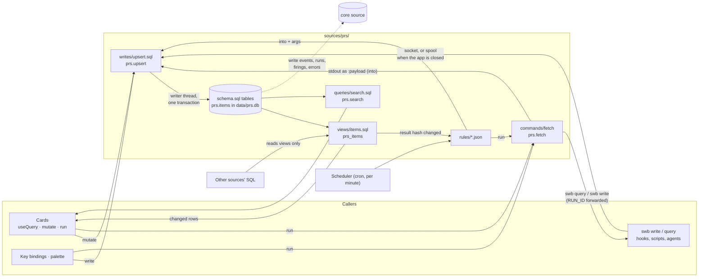
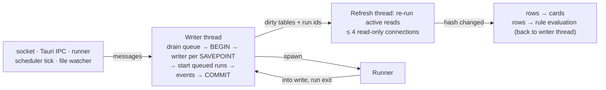

# Switchboard: architecture

A personal Tauri + React app for directing attention across Slack, Jira, PRs, monitoring and agents. Agents extend it by writing files to `~/.switchboard`, which the app checks and loads.

| Path             |                                                                                 |
| ---------------- | ------------------------------------------------------------------------------- |
| `core/`          | loader (incl. card compiler), engine, runner, snapshots, embedded `core` source |
| `cli/`           | `swb`                                                                          |
| `app/`           | shell (React + Vite) and the `switchboard` card module                            |
| `app/src-tauri/` | Tauri wrapper; bundles `swb` as a sidecar                                      |
| `template/`      | default folder contents                                                         |
| `.github/`       | manual release: bumps the version, builds the macOS DMG and Linux deb/rpm      |

## Principles

- Sources hold all data and logic. Cards only display.
- A source's tables are private. Its views are its public interface.
- Every write goes through the backend, as a named SQL writer.
- Rules are the only automatic trigger.
- Tables only grow. Schema changes are hidden behind views.
- The backend keeps no state outside `core` tables.
- One loader both checks and enforces. Dependencies are derived from the files, never declared.

## Folder: `~/.switchboard` (git repo, `data/` ignored)

```
settings.json            app-wide defaults and preferences
keymap.json              key → command or writer
rules/*.json             rules that belong to no single source
cards/*.tsx, cards/lib/  card components (Root.tsx is the entry point) and their helpers
sources/<name>/
  source.json            optional: item card, snapshot and timeout overrides
  schema.sql             private tables (no file = no database)
  views/*.sql            parameterless SELECTs: public, joinable, watchable
  queries/*.sql          parameterised SELECTs: callable by name, not joinable
  writes/*.sql           mutations of this source's tables
  commands/*             scripts that fetch or act
  rules/*.json           rules that belong to this source
  files/                 config and helpers for its commands; committed, not loaded
data/                    <source>.db (WAL), runs/, snapshots/, trash/, spool/, swb.sock, engine.lock
AGENTS.md                what agents need to maintain the folder
```

Every part of a source is optional; any other entry is a loader error. A source without a schema is a namespace for commands, queries or cross-source views.

## Inside a source



Only the source's writers write its tables, and everything else reads it through its views and queries. Commands call external systems, and read and write the source with `swb query` and `swb write`.

## Sources

| Form                                      | Meaning                     | Usable from                        |
| ----------------------------------------- | --------------------------- | ---------------------------------- |
| `prs.items`                               | private table, in SQL       | only files inside `sources/prs/`   |
| `prs_items`                               | view, in SQL and `useQuery` | anywhere                           |
| `prs.search`, `prs.dismiss`, `prs.fix-ci` | query, writer, command      | cards, rules, key bindings, `swb` |

Source names are `[a-z][a-z0-9]*` (no `_`, since views are `<source>_<file>`). A ref is `source:id`, e.g. `prs:4812`.

- **Views** are one parameterless `SELECT`, registered as temp views on the engine's connections (so they exist only inside the app; `swb query` reads them from outside). They read their own source's tables and any views. Their columns are their contract. `now` is evaluated only when the view re-runs, which is after a dependent write or on a rule's schedule.
- **Queries** are parameterised `SELECT`s for what a view plus equality filters cannot express. Not joinable, not watchable by rules.
- **Writers** are one or more statements run in one savepoint, with named params, writing only their own source. Bulk input arrives as JSON in `:payload`; `:run_id` is bound to the calling run.
- **Commands** are scripts that take IDs and look up the rest with `swb query`. They never open a database. A fetching command prints JSON and its rule's `into` writer stores it. They run with the folder as cwd, in their own process group, with the login-shell environment captured once at start, `RUN_ID`, `SWITCHBOARD_HOME`, `SOURCE_DIR`, `SWB` and `SWB_ARG_<NAME>` (args are also JSON on stdin), `swb`'s folder first on `PATH`, a timeout (setting, `source.json` or rule), and stdout and stderr in `data/runs/<run_id>/out` and `err`. Agent launches are ordinary commands: wait on `<agent> -p` and exit with its result, or detach, exit `open`, and finish later. A command listed in `source.json` `long_running` has no timeout, keeps its stdin open after the args line for `swb run input`, and does not count against `max_concurrency`: it runs until it exits or `swb run stop`, so it can hold a connection, such as an agent session, across many inputs.
- **Portability:** a source is self-contained; copying its folder in and passing `swb check` installs it. Its files contain its own name, so it cannot be renamed without editing them. Rules start firing as soon as it loads.

## Rules

```json
{ "id": "fix-failing-ci", "when": { "view": "prs_ci_failed" }, "key": "{id}@{head_sha}", "run": "prs.fix-ci", "args": { "pr": "{id}" } }
{ "id": "prs-poll", "when": { "schedule": "*/2 * * * *" }, "run": "prs.fetch", "into": "prs.upsert" }
```

- `when.view` is evaluated on load and whenever its result hash changes after a write. It fires once per new rendered key; seen keys live in `core.firings`.
- `when.schedule` is a local cron checked every minute. With a view, it re-evaluates the view; alone, it fires once per slot keyed `slot:<time>`. After sleep, only the most recent missed slot fires; a new rule starts at its next slot.
- `when.files` is a glob watched outside the folder. A matching file fires once it has been quiet for 200 ms, keyed `file:<path>@<time>`; with `when.line_contains`, once per appended complete line containing the text, keyed `file:<path>@<offset>`, at most 1 s after the file starts changing when only `line_contains` rules watch it, so a file written continuously still fires. Offsets start at each file's length when the rules load, so existing content never fires.
- `when.system` fires on `sleep`, `wake`, `lock`, `unlock`, `online`, `offline`, `idle` and `active`, keyed `system:<event>@<time>`. `idle` means no keyboard or pointer input for `idle_after` and no app holding the display awake (video does, audio only does not); the wrapper polls it every 15 s. On Linux, sleep, wake and lock come from logind, `online`/`offline` from NetworkManager, and `idle` from Mutter on GNOME (with GNOME's idle inhibitors), or logind's idle hint elsewhere. The app observes them and calls `Engine::system_event`; core debounces `offline` by `offline_debounce` and drops the `online` that ends a brief drop. A rule takes at most one of `schedule`, `files` and `system`, and like a schedule, each occurrence re-evaluates its view or fires it once.
- `run` starts a command; `into` names a writer that receives the command's stdout as `:payload`. A rule with only `into` calls the writer with `args`: with a view this still records a run (so depth applies), while a writer rule without a view records only its firing, writes with origin `rule:<id>` and no run, and starts a new lineage.
- Schedules are the only time mechanism. The loader warns when a rule watches a `now`-dependent view without a schedule.

Limits, all computed from `core` tables:

- **Depth:** a firing caused by writes from runs takes the deepest of those runs as parent. Past `max_depth` (5) it is blocked. `RUN_ID` reaches everything a command starts, and `swb write` forwards it.
- **Rate:** a rule with `when.view` or `when.files` that has started `max_per_hour` runs in the last hour (counted in `core.runs`) is blocked and disabled until `core.rule_enable`. Schedule and system rules are bounded by their cron and the machine.
- **Concurrency:** at most `max_concurrency` rule runs are `running` (`core.notify` exempt); the rest stay `queued`.
- A blocked firing records its reason and consumes its key; retrying is manual. Runs started by hand are never limited.

## Engine



- **Write path:** one writer connection with every source DB attached and every view as a temp view. Each loop iteration drains all pending messages into one transaction (group commit), then starts queued runs, writes buffered events, commits and replies.
- **Invalidation:** when the loader prepares a view or query, SQLite's authorizer reports every base table it reads, through any depth of views; writers report the tables they write. After a commit, every active read (subscribed by a card or watched by a rule) whose tables intersect the dirty set is queued for the refresh thread, which re-runs it so the writer never waits on a read. Queued refreshes run in order, and each read runs once for everything queued while the previous pass ran, so a slow read updates less often instead of slowing writes. Only a changed result hash is pushed to cards or evaluated by rules. Granularity is per table, and a whole result is re-sent when it changes.
- **Runner:** every command runs under `swb-hold`, a small std-only binary started in its own process group, which starts the command in another, copies its stdout to `data/runs/<run_id>/out` (16 MB cap) and stderr to `err` (1 MB cap), kills its group on timeout, stops it on SIGTERM (`swb run stop`: SIGTERM to the group, SIGKILL 5 s later), and writes `exit` (code, signal, reason) last. For a long-running command, stdin is the FIFO `in`, which `swb run input` writes one line at a time. The holder keeps the run folder `flock`ed while it lives and does not depend on the engine: quitting the app leaves runs running, and the next engine adopts each `running` run by waiting on that lock, then records the exit, `into` payload and outcome line as if it had never stopped. The tick marks `running` runs with neither a holder nor a process as `unknown`, and expired `open` runs too, and trims events, runs and run folders past `retention`.
- **Reload:** file changes (debounced 100 ms; `data/`, `.git` and `switchboard.d.ts` ignored) re-run the loader. Only a clean load is swapped in: connections are rebuilt, subscriptions re-resolved, rules re-synced, and changed cards pushed for hot reload; the app swaps a card in once its new version has loaded, so it neither blanks nor drops its subscriptions. Otherwise the last good state keeps running, and the errors go to `core_events` unless another reload follows within 15 s. A card module that fails to compile does not fail the load (only `swb check`): it is shipped as a module throwing its errors, so only cards in use surface them. A card version that fails within 15 s of replacing a working one, as while an agent is still editing it, shows the previous version until then; only then is its error shown and reported to `core_events` as `card_runtime`. If the folder fails at startup, the app runs the `core` source alone.
- **Socket:** `data/swb.sock` serves `swb`. On start, `data/spool/` is replayed in order before accepting connections.
- **Wrapper (Tauri):** one IPC command, `call`, for the shell (shared with other devices, below), `core.notify` as desktop notifications (clicking brings the window forward), the row count of the `badge` view as the dock badge on macOS or in the tray on Linux (whose menu shows or quits the app), the global `hotkey` (X11 only on Linux), and closing the window hides it. On macOS it offers once to link `swb` into `/usr/local/bin`, which takes an admin password; declining is remembered. One instance per folder, enforced by `data/engine.lock`; on Linux, launching the app again for the same folder shows the running window instead.

## Storage

- One SQLite file per source, attached under the source's name (attach limit raised to 125 at build time). Only the engine writes.
- **`schema.sql` is additive-only:** `CREATE TABLE` and `CREATE INDEX` only. New tables and columns are applied automatically; drops, renames and column definition changes are refused; indexes may change freely. Changes to table-level constraints are not detected.
- **Reshaping** is a new table, a one-off copy writer, and views switched to it. A new source is for redesigning the public interface.
- **`@deprecated`** on a column's line or above a `CREATE TABLE` makes the loader refuse views and queries that read it.
- **Orphans:** a DB whose source folder is gone moves to `data/trash/`, deleted after 30 days.
- **Snapshots:** every minute, a database changed since its latest snapshot and older than `snapshot_interval` is copied with `VACUUM INTO`; snapshots past `snapshot_retention` (2 days) are deleted, except the latest, which is only deleted once a newer one is written. `core.restore` snapshots the current data, restores via the backup API and reloads.
- **Conventions:** provider JSON in a `raw` column; user state in its own table joined in the view; a primary key on every table.

## Core source

Embedded in the binary, written only by the engine, and the only source whose schema may drop tables.

- **`runs`:** id (a UUID, chosen by the engine or by a device that queued the run offline; order is `created_at`), command, args, state, parent, depth, rule, pid, summary, commit, timestamps.
  ```
  queued → running → success | failure | open | stopped
  queued → stopped              (swb run stop)
  open → success | failure      (swb run finish, core.run_finish, or a rule)
  running → unknown             (process gone)
  open → unknown                (open_run_expiry)
  ```
  Exit code sets the state; a last stdout line `{outcome, summary}` refines it (except for `into` runs).
- **`firings`:** rule, key (unique together), run, time, blocked reason, commit. Kept long-term except trigger occurrence keys (`slot:`, `file:`, `system:`), trimmed after 7 days. A rule without a view can set `log: false` to record neither firings (other than blocked ones) nor write events; a view rule cannot, since its firings are what remember the keys it fired.
- **`rules`:** enabled, disabled reason, last evaluated.
- **`events`:** writes that changed rows (with trigger and run), errors of every kind (`loader`, `sql`, `card_runtime`, `spool`, `runner`, …), and reads slower than 100 ms (once per active read until it runs fast again). The engine's own bookkeeping writes produce no events.
- **Views:** `core_runs`, `core_firings`, `core_rules`, `core_items` (rules as `core:<rule>` refs) and `core_events` expose every row and never filter; consumers filter on top. Indexes cover the common filters (`kind`, `run_id`, `name`, `state`, `rule`, blocked firings). Mounting a view over a growing table re-sends the whole result after every write unless its filter keeps the result small; for recent history, cards use a query with a limit.
- **Queries** `core.timeline {limit}` (runs, firings and events, newest first) `core.events {kind, limit}` (newest events of a kind) and `core.runs {limit}` (newest runs).
- **Writers** `core.rule_enable` and `core.run_finish`; **commands** `core.snapshot`, `core.restore`, `core.notify`.

`attention` and the Health card are template sources and cards over these views and queries.

## Loader and `swb check`

One function takes the folder and returns a loaded configuration or diagnostics. The engine calls it on change, `swb check` and the git pre-commit hook call it directly.

- Each `schema.sql` runs in an in-memory scratch database under the authorizer; the real DB is opened read-only for the additive diff, and the plan is applied only after the whole folder passes.
- Every SQL file is prepared on a connection with the scratch DBs attached. A second pass replaces each view with an empty table of the same columns, so each reported table access belongs to the statement itself. This pass detects reads of other sources' tables, writes outside the source and reads of deprecated columns.
- It also checks: read-only views and queries, no parameters in views, no `SELECT *`, no `ATTACH`/`PRAGMA`/DDL/transactions/introspection table functions; rule references and that template variables are view columns; key binding targets; `source.json` and `settings.json` fields.
- Cards and `cards/lib/` are compiled in-process with oxc (TypeScript, JSX) into modules held in memory, with imports restricted to `react`, `react/jsx-runtime`, `switchboard` and `cards/lib/`.
- Warnings: unused views and queries, a missing root card, `now` views watched without a schedule.

## `swb` CLI

Talks to the app over `data/swb.sock`.

- `swb write <source.writer> [name=value ...] [< payload]`: spooled to `data/spool/` if the app is closed; at-least-once.
- `swb query <view | source.query> [name=value ...]`
- `swb run start <source.command> [name=value ...]`: prints the run id; started from a command, the run is its child.
- `swb run finish <run_id> --ok|--fail [summary]`
- `swb run input <run_id> [text]`: one line, or stdin, to a long-running run.
- `swb run stop <run_id>`
- `swb check`
- `swb init [<git url> [--copy | -c]] [--force | -f]`: replaces the folder with a clone of the URL that keeps it as `origin` (to pull the template's updates; it ignores `data/` and `cards/switchboard.d.ts` through `.git/info/exclude`), a new repository with the URL's files given `--copy`, or the built-in template without a URL, which is also how the app creates a missing folder. The new folder is built next to the old one and swapped in once complete. Without `--force`, only a missing folder or one still at its first commit with no changes; never while the app holds `data/engine.lock`.

## Front end

The shell renders one root card. All layout is cards rendering cards.

- **Shell owns:** `<CardSlot>`, the palette (cmd-shift-p: shell commands, commands and writers), keymap and context stack, focus, and an error boundary whose root instance offers "revert last commit".
- **`<CardSlot component props size id>`** is the only way cards compose. Each slot has its own error boundary and context frame. Nesting is capped at `depth_cap`.
- **`<Item ref>`** renders a ref with its source's `item_card`, or as text.
- **Card API** (`switchboard` module, provided at runtime like React): `useQuery` on a view (with equality filters) or a query, `mutate`, `run`, `useExpose`, `useCards` (card names from the config). Identical subscriptions are shared. The app writes `cards/switchboard.d.ts` on start.
- Cards are fetched over IPC as compiled module bundles and evaluated in the webview; each card gets its own instance of the helpers it imports.
- **State:** navigation and layout are data in the view-less `ui` source; other per-slot state is in local storage keyed by the slot id.
- **Undo:** `git revert` for the folder, `core.restore` for data.

## Other devices

With `remote` set when the app starts, the wrapper runs `tailscale up` if Tailscale is logged in but stopped, serves the shell on a local port and runs `tailscale serve --bg --https=<remote>` to it, so the board opens at `https://<device>.<tailnet>.ts.net:<remote>` on your other devices (installed on a phone as a home-screen web app). Everything still executes on the desktop.

- **Server** (`app/src-tauri/src/remote.rs`): `GET /*` serves the built shell, `POST /api/<command>` runs the same `call` as IPC with trigger `remote`, and `GET /api/events` is a server-sent event stream per client carrying `rows` (only for that client's subscriptions), `config` and `card`. A client's subscriptions end with its stream.
- **Access:** a request must carry the `Tailscale-User-Login` of the desktop's own user (set by `tailscale serve`, which strips it from incoming requests), the `ts.net` host, and for `/api/` no cross-site `Origin` or `Sec-Fetch-Site`. The port listens on `127.0.0.1` only. No token: Tailscale is the pairing.
- **Cache:** every `config`, `card` and `rows` response is kept in IndexedDB, keyed like subscriptions (`name + JSON(params)`), and answers when the desktop is unreachable or takes over 3 s to answer (a network that hangs, as while a phone's VPN reconnects), with an "as of" time. Once offline, these reads go straight to the cache. The app shows offline when a request fails, or when the desktop has not answered anything for 3 s while the stream (on start, or after it drops, as iOS does in the background) has not said hello; until it does, the stream is reopened every 3 s, since a connection made before the network was up can hang long after a new one would succeed. A subscription never seen before stays loading. A service worker keeps the shell itself: fetched from the desktop when it answers within 3 s, else from the cache.
- **Outbox:** `mutate` and `run` made offline are queued in IndexedDB and sent in order when the stream reconnects or the app returns to the foreground. Writes never expire and are at-least-once, like the spool. Runs carry an id chosen on the device, so sending one twice starts it once, and are dropped after `queue_run_expiry` (or `source.json` `queue_expiry`; `0` refuses to queue). The shell lists pending, failed and expired items until cancelled or dismissed.
- **Reconnect:** a new stream is a new client: subscriptions are opened again, cards refetched and the config reloaded.
- **Push:** an installed app asks once, in a toast, to enable notifications, and sends its `PushManager` subscription to the desktop, which keeps it and its VAPID key pair in `data/push.json` (wrapper state that no card or rule reads). `core.notify` always shows the desktop notification, and is also pushed (`web-push-native`) when `push` allows: `always`, `locked` (screen locked), `idle` (locked or idle as above, checked when the notification fires), or `off`. Tapping it opens the app. A subscription the push service reports gone is dropped.

## Keymap

- The context stack is the chain of focused card frames, e.g. `card:Root > card:Boards > card:Grid > card:PRList`. `size` and `focused` are reserved variables; others come from `useExpose`.
- Bindings target a command or a writer, with predicates `&&`, `||`, `!`, `>` and parentheses. The innermost match wins, `null` unbinds, a missing variable disables the binding (greyed in the palette), and variables are read at keypress.
- `keymap.context` shows the active stack and which binding a key hits.

## Default template

When the folder is missing, the app creates it as `swb init` does without a URL: `template/` with a `.gitignore` for `data/`, `git init`, the pre-commit hook and a first commit, built next to the folder and moved in once complete. Remote access is off. The template's sources and cards are ordinary files and can be replaced.

- **`sessions`:** every Claude Code session whose settings include `files/claude-hooks.json` reports to `sessions.items` through `files/hook`: status (`working`, `needs_permission`, `needs_input`, `ready`, `errored`, `ended`), the host app (`__CFBundleIdentifier`, else `TERM_PROGRAM`), the entrypoint, and the last prompt and assistant message. `sessions.agents` mirrors `claude agents --json --all` (background sessions and interactive ones still open), refreshed by `sessions.sync` every minute and whenever `~/.claude/sessions/*.json` or `~/.claude/jobs/*/state.json` change; `sessions_items` merges both, preferring Claude's own state. No hook fires on an interrupt, so the `sessions-interrupted` rule watches transcripts (`when.files` with `line_contains`) for Claude's interrupt marker and sets the session back to `ready`. The `PermissionRequest` hook (`files/decide`) records the pending decision and waits for `sessions.decide`; an answer given in the session's own UI first wins, and the hook then exits without one. Pending decisions raise attention items (`sessions-pending`, level 2, titled by folder) that `sessions-resolved` clears once answered. `sessions.start {prompt, cwd?, model?, attachments?}` starts a background session (`claude --bg`, `opus` unless `model` says otherwise). `sessions.send {session, text, attachments?, interject?}` pokes interactive sessions still open and otherwise resumes the session in the background, stopping a running turn first; `interject` asks it to also finish that turn's task. `sessions.poke {session, text, attachments?}` has a headless Haiku session `SendMessage` the session's messaging socket with a Switchboard envelope. Attachments are staged with `sessions.attach`, saved by `files/attach` under `data/attachments/` and opened with `sessions.reveal`. `sessions.open {session}` attaches background sessions in a new terminal, shows Zed sessions in Zed's agent panel (Zed cannot open a given thread), and otherwise resumes them with `sessions.launch {prompt?, cwd?, session?, attach?}` in the terminal from settings. `sessions.transcript {session}` loads a transcript on demand into `sessions.messages` (one row per user or assistant message, tool calls and results cut to 300 characters, images shown as `[image]`, thinking dropped); the `sessions-transcripts` rule (`line_contains` on every transcript line, `log: false`) then adds lines appended to open transcripts only, until `sessions.transcript_close`. Cards read the latest messages through the `sessions.transcript {session, limit}` query.
- **`attention`:** items with one open per ref and an optional title; `raise`, `clear`, `snooze`, `wake`. Rules wake due snoozes every minute, `core.notify` for items of level ≥ 2 when raised and each time they wake from a snooze (up to 60 per hour), and raise blocked firings.
- **`ui`:** boards, grid tiles, and the current board per client (`desktop`, `mobile`). With no boards, `Boards` shows an implicit Main `Grid`. `ui_defaults` is a full-width `Sessions` tile.
- **Cards:** `Root` (injects the shared styles from `cards/lib/theme.ts`, floats `Health` as a chip, and on a phone-sized touch screen sets `data-mobile` on `<html>` and shows boards for the `mobile` client), `Boards` (tabs, closable except `main` through `ui.close_board`, transcript tabs coloured by session state; `layout: "list"` for `mobile`), `Grid` (fills the window; add and restore at the top; drag, resize from the corner grip, add from a filtered card picker (`useCards`, without `Root`, `Boards` and `Grid`), and a Restore default cards button while the grid lacks any card from `ui_defaults`, which calls `ui.reset`; with `layout: "list"`, its tiles stacked in reading order, with add and remove but no moving), `Health` (only as Root's chip and its popover; Clear all hides errors up to the newest one through `attention.clear_errors`), `SessionBox` (starts a session in this folder or another), `Sessions` (`SessionBox` at the top; status, last prompt and reply, decisions, a message box with attachments that queues follow-ups while Claude is working (shown faded, with Cancel, which moves it back into the box, and Interrupt, which sends it now as an interjection), External, Transcript, which opens a `Transcript` board through `ui.open_board`, collapse, and hide into `sessions.hidden` with a Show hidden view), `Transcript` (a session's latest messages as markdown, with the same message box). Markdown uses `marked`, vendored as `cards/lib/marked.js`, behind `cards/lib/markdown.ts`, which shows raw HTML and images as text and keeps only http(s) and mailto links, since card HTML runs in the webview that can start commands. `badge` is `attention_open`. No seed data.

## Deferred

- Generated TypeScript types for views and queries; typechecking cards in the loader.
- Dropping deprecated, unreferenced columns and tables.
- `swb import <path | git url>` registering rules as disabled.
- Full-text search (virtual tables are refused).
- npm packages in cards.
